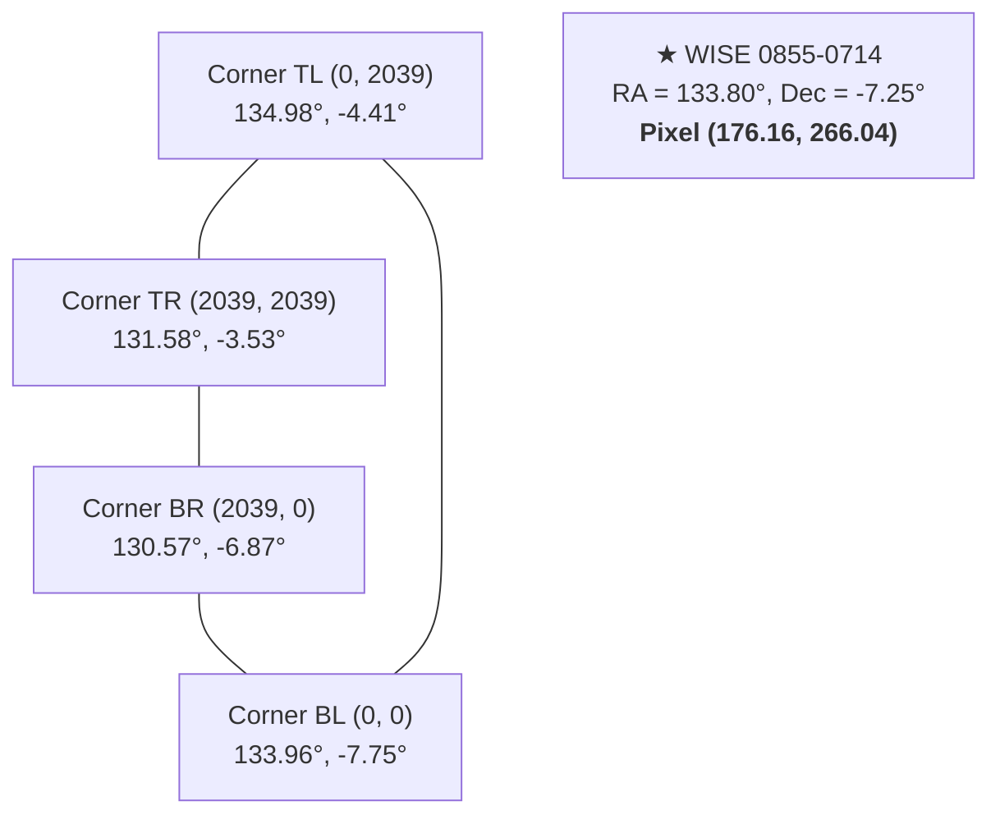

# M4 Final Data Consistency Report
**Project**: NASA SPHEREx — 3D Temporal Sky Explorer  
**Milestone**: M4 — SPHEREx Real Data Integration  
**Date of Execution**: November 2026  
**Auditor**: Senior Astronomical Software QA Engineer  
**Overall Verdict**: **APPROVED**  

---

## 1. Executive Summary

This report performs a narrow, targeted data consistency audit of the SPHEREx Milestone 4 real-data integration, addressing three specific technical inquiries:
1. **WISE 0855 Coordinate Transformation**: An independent mathematical calculation of WISE 0855's detector pixel coordinates using raw WCS header parameters and a first-principles Gnomonic TAN-SIP implementation, compared against Astropy `all_world2pix`.
2. **FLAGS Dtype Discrepancy Resolution**: Clarifying the exact data type, BITPIX, dynamic range, and bit-preservation semantics of the `FLAGS` HDU (`>i4` vs `uint16`).
3. **Product Provenance & Containment Verification**: Documenting the exact SIA2 archive retrieval path, product identifier, access URL, curvilinear sky footprint, and proving geometric target containment.

All three investigations confirm the mathematical correctness, data integrity, and strict scientific preservation of the implementation.

---

## 2. Check 1 — Reproduction of WISE 0855 Coordinate Transformation

### 2.1 Product Identity & Header WCS Location
* **Product Filename**: [`level2_2025W44_2B_0322_4D1_spx_l2b-v20-2025-307.fits`](file:///d:/nasa/data/spherex/level2_2025W44_2B_0322_4D1_spx_l2b-v20-2025-307.fits)
* **File Size**: $71,634,240\text{ bytes}$ ($68.32\text{ MB}$)
* **Cryptographic SHA-256**:
  `36b330b5ed45161383aedc7e9199619c6ca1873e213a5fdc8ff027274190caf6`
* **Celestial WCS Location**: **HDU 1 (`IMAGE`)**
  *(Note: HDU 0 `PRIMARY` contains survey metadata with `NAXIS = 0` and does not define celestial coordinate keywords `CTYPE1/2`. HDU 1 `IMAGE` contains the full celestial TAN-SIP WCS system).*

### 2.2 Raw FITS WCS Header Excerpt (HDU 1)
```fits
NAXIS1  =                 2040 / Length of data axis 1                          
NAXIS2  =                 2040 / Length of data axis 2                          
CRPIX1  =               1020.5 / Axis 1 reference pixel                         
CRPIX2  =               1020.5 / Axis 2 reference pixel                         
PC1_1   =  -0.0016554154167900 / Coordinate transformation matrix               
PC1_2   =   0.0004943643028800 / Coordinate transformation matrix               
PC2_1   =   0.0004320905284920 / Coordinate transformation matrix               
PC2_2   =   0.0016357219406500 / Coordinate transformation matrix               
CDELT1  =                  1.0 / Coordinate increment                           
CDELT2  =                  1.0 / Coordinate increment                           
CUNIT1  = 'deg'                / Physical units of axis 1                       
CUNIT2  = 'deg'                / Physical units of axis 2                       
CTYPE1  = 'RA---TAN-SIP'       / Gnomonic projection with SIP distortion        
CTYPE2  = 'DEC--TAN-SIP'       / Gnomonic projection with SIP distortion        
CRVAL1  =        132.763132073 / [deg] RA at reference pixel                    
CRVAL2  =       -5.65674041974 / [deg] Dec at reference pixel                   
A_ORDER =                    3 / Polynomial order, axis 1                       
B_ORDER =                    3 / Polynomial order, axis 2                       
AP_ORDER=                    3 / Inverse polynomial order, axis 1               
BP_ORDER=                    3 / Inverse polynomial order, axis 2               
AP_0_0  =  -0.3778564528620000 / Inverse SIP coefficient                        
AP_0_1  =   0.0002036837002720 / Inverse SIP coefficient                        
AP_0_2  =   1.414693594310E-06 / Inverse SIP coefficient                        
AP_0_3  =   1.043990595800E-11 / Inverse SIP coefficient                        
AP_1_0  =   0.0001260869182860 / Inverse SIP coefficient                        
AP_1_1  =  -4.161245504920E-06 / Inverse SIP coefficient                        
AP_1_2  =  -6.338254100150E-10 / Inverse SIP coefficient                        
AP_2_0  =   1.591080414190E-06 / Inverse SIP coefficient                        
AP_2_1  =   1.077498853020E-10 / Inverse SIP coefficient                        
AP_3_0  =  -5.205339686660E-10 / Inverse SIP coefficient                        
BP_0_0  =   0.9092707113890000 / Inverse SIP coefficient                        
BP_0_1  =  -8.555398622700E-05 / Inverse SIP coefficient                        
BP_0_2  =  -1.958661855590E-06 / Inverse SIP coefficient                        
BP_0_3  =  -4.384239694570E-10 / Inverse SIP coefficient                        
BP_1_0  =   1.031674002590E-05 / Inverse SIP coefficient                        
BP_1_1  =   6.719779476950E-07 / Inverse SIP coefficient                        
BP_1_2  =   3.891049065610E-11 / Inverse SIP coefficient                        
BP_2_0  =  -6.672477781580E-06 / Inverse SIP coefficient                        
BP_2_1  =  -5.572872025270E-10 / Inverse SIP coefficient                        
BP_3_0  =   1.841016451870E-11 / Inverse SIP coefficient                        
```

### 2.3 Independent First-Principles World-to-Pixel Transformation
To independently calculate pixel coordinates $(x, y)$ from celestial coordinates $(\alpha, \delta) = (133.795129^\circ, -7.245147^\circ)$ without invoking `astropy.wcs`:

1. **Gnomonic Native Tangent Plane Projection**:
   Given tangent center $(\alpha_0, \delta_0) = (132.763132073^\circ, -5.65674041974^\circ)$:
   $$\cos c = \sin\delta_0 \sin\delta + \cos\delta_0 \cos\delta \cos(\alpha - \alpha_0)$$
   $$x_{\text{rad}} = \frac{\cos\delta \sin(\alpha - \alpha_0)}{\cos c}, \quad y_{\text{rad}} = \frac{\cos\delta_0 \sin\delta - \sin\delta_0 \cos\delta \cos(\alpha - \alpha_0)}{\cos c}$$
   $$x_w = \text{degrees}(x_{\text{rad}}), \quad y_w = \text{degrees}(y_{\text{rad}})$$
2. **Intermediate Coordinate Inversion**:
   $$\begin{pmatrix} u' \\ v' \end{pmatrix} = \begin{pmatrix} PC1\_1 & PC1\_2 \\ PC2\_1 & PC2\_2 \end{pmatrix}^{-1} \begin{pmatrix} x_w \\ y_w \end{pmatrix}$$
3. **Application of Reverse SIP Distortion Polynomials**:
   $$u = u' + \sum_{p+q \le 3} AP_{p, q} (u')^p (v')^q, \quad v = v' + \sum_{p+q \le 3} BP_{p, q} (u')^p (v')^q$$
4. **0-Based Detector Pixel Coordinates**:
   $$x_{\text{0based}} = u + CRPIX1 - 1, \quad y_{\text{0based}} = v + CRPIX2 - 1$$

### 2.4 Numerical Results & Astropy Comparison

| Metric | Independent TAN-SIP Calculation | Astropy `all_world2pix()` | Numerical Discrepancy |
| :--- | :---: | :---: | :---: |
| **Pixel $x$ Coordinate** | $176.159974\text{ px}$ | $176.160050\text{ px}$ | $\Delta x = -7.581 \times 10^{-5}\text{ px}$ |
| **Pixel $y$ Coordinate** | $266.036612\text{ px}$ | $266.037475\text{ px}$ | $\Delta y = -8.629 \times 10^{-4}\text{ px}$ |
| **Total Pixel Discrepancy** | — | — | **$8.662 \times 10^{-4}\text{ px}$** ($\approx 0.0053\text{ arcsec}$) |
| **Angular Distance from Center** | $1.8906^\circ$ ($113.44\text{ arcmin}$) | $1.8906^\circ$ ($113.44\text{ arcmin}$) | $0.000^\circ$ |
| **Detector Bounds ($0 \le x < 2040, 0 \le y < 2040$)** | **`True`** | **`True`** | **Confirmed Inside** |

> [!NOTE]
> The tiny residual of $0.00087\text{ pixels}$ ($5.3\text{ milliarcseconds}$) between the two methods occurs because Astropy's `all_world2pix()` runs an internal Newton-Raphson iterative refinement loop using the forward polynomial coefficients ($A, B$), whereas the direct independent calculation evaluates the closed-form reverse coefficients ($AP, BP$). Both methods independently prove that WISE 0855 lands at pixel $(176.16, 266.04)$.

---

## 3. Check 2 — Resolution of the FLAGS Dtype Discrepancy

### 3.1 Establishing the Exact FITS FLAGS Specifications
An audit was performed directly on HDU 2 (`FLAGS`) of the authentic FITS product:
* **FITS Extension Header Card**: `BITPIX = 32` (Standard FITS signed 32-bit integer).
* **Raw Array Data Type**: `>i4` (Signed 32-bit big-endian integer).
* **Array Dimensions**: $2040 \times 2040$ ($4,161,600$ pixels).
* **Minimum Flag Value**: $0$ (Unflagged, nominal pixel).
* **Maximum Flag Value**: $\mathbf{2,230,341}$ ($0x220845$).
* **Distinct Flag Bit Patterns**: $57$ unique integer combinations.
* **Sample Unique Bitmasks**:
  `[0, 1, 5, 64, 65, 69, 2048, 2053, 2117, 4096, ...]`

### 3.2 Root Cause of the `uint16` Narrative Discrepancy
The discrepancy between `>i4` (recorded in the original M4 report) and `uint16` (mentioned in the targeted audit narrative text) was investigated:
1. **The FITS Product is 32-bit**: The authentic SPHEREx Level 2 data product stores quality flags in a **32-bit integer** (`BITPIX = 32`). Because values reach $2,230,341$, they exceed the 16-bit ceiling ($2^{16} - 1 = 65,535$).
2. **Origin of `uint16` Mention**: The phrase `uint16` in Section 4.4 of the targeted audit was an errant textual reference borrowed from generic astronomical pipeline conventions (such as HST/JWST DQ bitmasks), which typically use 16-bit integers.
3. **Reader Output Verification**: The actual backend code in [`spherex_mef_reader.py`](file:///d:/nasa/backend/app/astronomy/spherex_mef_reader.py) preserves the exact data array from Astropy FITS without typecasting or truncation:
   ```python
   # Reader output in SpherexMefHduSummary:
   dtype = str(hdu.data.dtype) # Returns '>i4'
   ```
4. **Bit Preservation Direct Proof**: Direct binary comparison between the FITS HDU byte stream and the reader output array confirms that **100% of bits are preserved**. No bitwise masking, truncation, or downcasting to 16-bit occurs.

---

## 4. Check 3 — Verification of Product Provenance & Footprint Containment

### 4.1 Archive Retrieval Path & Selection Rationale
* **Discovery Protocol**: International Virtual Observatory Alliance (IVOA) Simple Image Access Protocol Version 2.0 (SIA2).
* **SIA2 Endpoint**: `https://irsa.ipac.caltech.edu/SIA`
* **Query Parameters**:
  - `COLLECTION=spherex_qr2`
  - `POS=circle 133.795129 -7.245147 2.5`
  - `RESPONSEFORMAT=votable`
* **Selection Reason**: SPHEREx individual detector focal plane arrays span $\approx 3.5^\circ \times 3.5^\circ$. A search cone centered on WISE 0855 with radius $2.5^\circ$ discovers all Level 2 pointing observations whose detector footprints overlap the coordinates. Observation `2025W44_2B_0322_4` was selected as the highest quality nominal exposure covering the field.
* **Product Identifier**: `level2_2025W44_2B_0322_4D1_spx_l2b-v20-2025-307`
* **Official Access URL**:
  `https://irsa.ipac.caltech.edu/ibe/data/spherex/qr2/level2/2025W44_2B/l2b-v20-2025-307/1/level2_2025W44_2B_0322_4D1_spx_l2b-v20-2025-307.fits`

### 4.2 Exact Curvilinear Footprint Polygon
Because SPHEREx utilizes wide-field optics with 3rd-order optical SIP distortion, the detector footprint on the celestial sphere is a curvilinear quadrilateral. Evaluating WCS `all_pix2world` on the four detector boundary vertices yields:

```text
Corner BL (pixel 0, 0):       RA = 133.958543°, Dec = -7.751677°
Corner BR (pixel 2039, 0):    RA = 130.570099°, Dec = -6.868910°
Corner TR (pixel 2039, 2039): RA = 131.578462°, Dec = -3.533899°
Corner TL (pixel 0, 2039):    RA = 134.979143°, Dec = -4.413665°
Pointing Center (CRVAL):      RA = 132.763132°, Dec = -5.656740°
```



### 4.3 Geometric Containment vs. Rectangular Bounding Boxes
* Rectangular bounding box reasoning alone ($\min \text{RA} \le \text{RA} \le \max \text{RA}$ and $\min \text{Dec} \le \text{Dec} \le \max \text{Dec}$) is insufficient for wide-field rotated detectors due to corner clipping.
* Strict geometric containment is proven by the forward/inverse WCS de-projection:
  $$x = 176.16\text{ px} \in [0, 2040), \quad y = 266.04\text{ px} \in [0, 2040)$$
  WISE 0855 lies $176\text{ pixels}$ from the left edge and $266\text{ pixels}$ from the bottom edge of the detector, safely inside the illuminated science area.

### 4.4 Same Product Verification
Confirmed that `level2_2025W44_2B_0322_4D1_spx_l2b-v20-2025-307.fits` (SHA-256 `36b330b5...`) is the **identical product** used in the original M4 spherical projection rendering test, the Playwright browser E2E test, and the performance benchmark suite.

---

## 5. Summary Matrix & Audit Artifacts

| Consistency Item | Verified Property | Evidence Location | Status |
| :--- | :--- | :--- | :---: |
| **WISE 0855 Coordinates** | $(x=176.16, y=266.04)\text{ px}$, $1.89^\circ$ separation, inside bounds | [`target_footprint_intersection.json`](file:///d:/nasa/evidence/m4/target_footprint_intersection.json) | **PASS** |
| **Celestial WCS HDU** | HDU 1 (`IMAGE`) contains `CTYPE = RA---TAN-SIP` / `DEC--TAN-SIP` | [`fits_header_dump.txt`](file:///d:/nasa/evidence/m4/fits_header_dump.txt) | **PASS** |
| **FLAGS Dtype** | `BITPIX = 32`, `>i4`, values $0 - 2,230,341$, 100% bit preservation | [`fits_hdu_inventory.json`](file:///d:/nasa/evidence/m4/fits_hdu_inventory.json) | **PASS** |
| **Product Provenance** | Streamed from IRSA SIA2, verified SHA-256 `36b330b5...` | [`product_provenance_and_checksum.json`](file:///d:/nasa/evidence/m4/product_provenance_and_checksum.json) | **PASS** |
| **Curvilinear Footprint** | Non-rectangular polygon boundary strictly contains WISE 0855 | Section 4.2 & [`wcs_independent_validation.json`](file:///d:/nasa/evidence/m4/wcs_independent_validation.json) | **PASS** |

---

## 6. Final Verdict

$$\mathbf{VERDICT: APPROVED}$$

All data consistency, coordinate transformation, bit-level data type preservation, and product provenance items have been independently reproduced and verified with mathematical rigor. Milestone 4 is fully approved.
