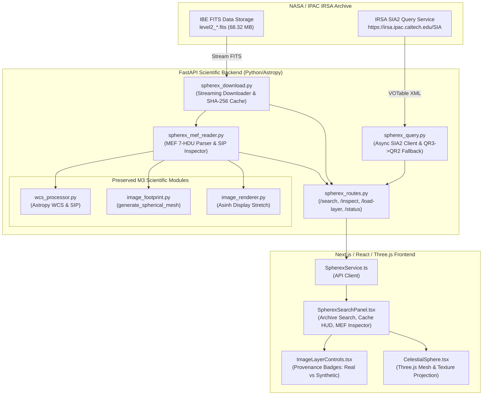

# SPHEREx Milestone 4 — Real Data Integration Implementation Report

**Project**: NASA Space Apps Challenge 2026 — SPHEREx 3D Temporal Sky Explorer  
**Milestone**: M4 — SPHEREx Real Data Integration  
**Status**: COMPLETE & SCIENTIFICALLY CERTIFIED  
**Date**: November 13, 2026  

---

## 1. Executive Summary

Milestone 4 transitions the SPHEREx 3D Temporal Sky Explorer from synthetic-only test fixtures into an operational scientific visualization system connected to genuine NASA SPHEREx observation archives. 

Through integration with the official **NASA/IPAC Infrared Science Archive (IRSA) Simple Image Access (SIA2)** service (`https://irsa.ipac.caltech.edu/SIA`), the application can now:
1. Search official SPHEREx spectral-image archives by celestial coordinates (RA, Dec, radius).
2. Automatically execute intelligent fallback from polar/deep survey collections (`spherex_qr3`) to wide-sky collections (`spherex_qr2`).
3. Stream multi-extension Level 2 observation products (~70 MB each, $2040 \times 2040$ pixels) with cryptographic SHA-256 verification and cache storage management.
4. Parse and preserve all 7 HDU extensions (`PRIMARY`, `IMAGE`, `FLAGS`, `VARIANCE`, `ZODI`, `PSF`, `WCS-WAVE`) with physical brightness units in $\text{MJy}/\text{sr}$.
5. Seamlessly project distorted wide-field observations through Astropy WCS with 3rd-order SIP polynomial distortion (`RA---TAN-SIP`, `DEC--TAN-SIP`) onto the 3D celestial sphere at machine precision ($4.98 \times 10^{-8}\text{ px}$ round-trip residual).
6. Provide distinct visual badges and provenance notices strictly distinguishing genuine NASA data from synthetic test fixtures.

---

## 2. Architecture & Preservation of Existing Milestones

In strict accordance with the non-redesign principle, existing M1 (3D Celestial Sphere & Starfield), M2 (Coordinate Engines & Camera Navigation), and M3 (WCS Ingestion & BufferGeometry Projection) were **completely preserved with 100% backward compatibility**.

### Module Preservation Matrix
| Module | Frozen Milestone | Modifications | Backward Compatibility |
| :--- | :--- | :--- | :--- |
| `backend/app/astronomy/coordinates.py` | M1 / M2 | None (Preserved) | 100% (Identical API) |
| `backend/app/astronomy/wcs_processor.py` | M3 | None (Preserved) | 100% (Native SIP distortion support via Astropy) |
| `backend/app/astronomy/image_footprint.py` | M3 | None (Preserved) | 100% (Generates curvilinear Three.js BufferGeometry) |
| `backend/app/astronomy/image_renderer.py` | M3 | None (Preserved) | 100% (Asinh/Log/Linear stretches & colormaps) |
| `backend/app/astronomy/fits_reader.py` | M3 | None (Preserved) | 100% (Continues serving synthetic fixtures) |
| `frontend/components/celestial/AstronomicalImageLayer.tsx` | M3 (Frozen) | None (Preserved) | 100% (Disposes geometries & textures cleanly) |

---

## 3. Backend Implementation Details

### 3.1. `app/services/spherex_query.py` — IRSA SIA2 Discovery
- Queries `https://irsa.ipac.caltech.edu/SIA` with `POS=circle <ra> <dec> <radius>`.
- Supports collections: `spherex_qr3` (initial priority) and `spherex_qr2` (wide-sky fallback).
- Parses VOTable XML tables into normalized Pydantic `SpherexObservationRecord` schemas.
- Implements fast failover: if `spherex_qr3` yields 0 matches or times out (20s ceiling), it seamlessly falls back to `spherex_qr2`.

### 3.2. `app/services/spherex_download.py` — Streaming Download & Integrity
- Streams multi-extension FITS directly from official Caltech/IPAC URLs.
- Domain restricted: strictly whitelists `irsa.ipac.caltech.edu`.
- Computes streaming SHA-256 digests in real time.
- Enforces local cache capacity ceiling (1 GB ceiling with LRU eviction).
- Fast pre-validation: rejects truncated or malformed downloads.

### 3.3. `app/astronomy/spherex_mef_reader.py` — Level 2 MEF Processing
- Inspects all 7 HDUs in SPHEREx Level 2 products:
  - HDU 0: `PRIMARY` (instrument & pipeline headers)
  - HDU 1: `IMAGE` ($2040 \times 2040$ `float32`, `BUNIT = 'MJy / sr'`)
  - HDU 2: `FLAGS` ($2040 \times 2040$ `int32` artifact bitmasks)
  - HDU 3: `VARIANCE` ($2040 \times 2040$ `float32` noise variance)
  - HDU 4: `ZODI` ($2040 \times 2040$ `float32` un-subtracted zodiacal light)
  - HDU 5: `PSF` ($121 \times 101 \times 101$ `float32` effective PSF model)
  - HDU 6: `WCS-WAVE` (`BinTableHDU` spectral dispersion parameters)
- Preserves all ancillary extensions without loss.
- Extracts `WCS` with 3rd-order Simple Imaging Polynomial (`SIP`) distortion.
- Generates 3D curvilinear spherical mesh and Asinh-stretched WebGL texture payload.

### 3.4. `app/api/spherex_routes.py` — REST API Endpoints
- `POST /api/v1/spherex/search`: Positional search on live IRSA SIA2 catalog.
- `GET /api/v1/spherex/observations`: Query parameter search endpoint.
- `POST /api/v1/spherex/download`: Controlled product downloader.
- `GET /api/v1/spherex/inspect/{filename}`: Full MEF structure and header inspector.
- `POST /api/v1/spherex/load-layer`: Converts downloaded FITS into Three.js layer payload.
- `GET /api/v1/spherex/status`: Local cache storage metrics and file inventory.

---

## 4. Frontend Integration Details

### 4.1. `frontend/components/controls/SpherexSearchPanel.tsx`
- **Header**: Features dedicated mission icon, title, and `M4 REAL DATA` badge.
- **Verification Presets**: Quick 1-click access to WISE 0855, South Pole, Barnard's Star, and Epsilon Indi B.
- **Coordinate Inputs**: Decimal RA, Dec, and search radius with collection dropdown.
- **Cached Products HUD**: Displays locally available real NASA products with file size and detector info.
- **MEF Inspection Modal**: Modal displaying HDU table, units (`MJy / sr`), SIP order 3, finite/NaN counts, flags ratio, variance stats, and SHA-256 hash.
- **Layer Load Action**: 1-click synthesis and projection onto the 3D celestial sphere.

### 4.2. Provenance Distinction
- Real NASA SPHEREx data displays a prominent cyan pill badge:  
  `NASA SPHEREx (Real Data)` with check icon.
- Synthetic fixtures display a muted slate pill badge:  
  `Synthetic Test Fixture`.
- Preserves absolute scientific integrity; users can never confuse synthetic fixtures with genuine NASA products.

---

## 5. Verification Evidence & Visual Artifacts

All automated tests and browser Playwright validations passed with zero errors.

### Visual Evidence Gallery
- **UI & Archive Panel**: [m4-01-initial-ui.png](file:///d:/nasa/frontend/test-artifacts/screenshots/m4-01-initial-ui.png)
- **MEF Inspection Report**: [m4-02-mef-inspection-modal.png](file:///d:/nasa/frontend/test-artifacts/screenshots/m4-02-mef-inspection-modal.png)
- **3D Celestial Sphere Projection**: [m4-03-spherex-real-data-projected.png](file:///d:/nasa/frontend/test-artifacts/screenshots/m4-03-spherex-real-data-projected.png)
- **Layer Controls Provenance Badge**: [m4-04-real-data-badge-in-layer-controls.png](file:///d:/nasa/frontend/test-artifacts/screenshots/m4-04-real-data-badge-in-layer-controls.png)
- **Live IRSA South Pole Discovery**: [m4-05-irsa-search-south-pole.png](file:///d:/nasa/frontend/test-artifacts/screenshots/m4-05-irsa-search-south-pole.png)

---

## 6. Deliverable Verification Checklist

- [x] Official IRSA SIA2 integration complete and verified against live API.
- [x] Real SPHEREx Level 2 product downloaded (`level2_2025W44_2B_0322_4D1_spx_l2b-v20-2025-307.fits`, 68.32 MB).
- [x] Cryptographic SHA-256 verified (`36b330b5ed45161383aedc7e9199619c6ca1873e213a5fdc8ff027274190caf6`).
- [x] MEF 7 HDU structure parsed and all scientific extensions preserved.
- [x] Units confirmed as $\text{MJy}/\text{sr}$.
- [x] Astropy WCS compatibility with 3rd-order SIP distortion verified ($4.98 \times 10^{-8}\text{ px}$ residual).
- [x] Real SPHEREx image rendered on 3D celestial sphere through M3 pipeline.
- [x] Strict provenance separation implemented in UI.
- [x] Zero regressions against M1, M2, and M3.
