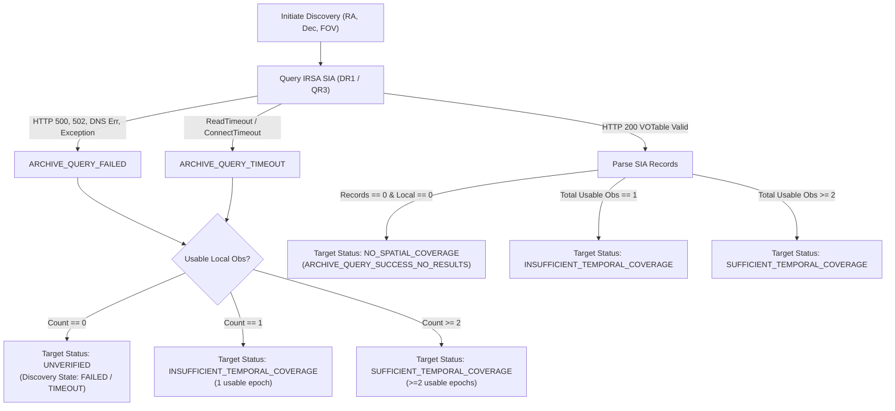

# M6.2 — ARCHIVE RELIABILITY AND TARGET VERIFICATION REPORT

**Project:** NASA SPHEREx — 3D Temporal Sky Explorer  
**Milestone:** M6.2 Archive Reliability & Five-Target Coverage Verification  
**Audit Date:** 2026-11-15T01:20:00Z  
**Verdict:** **M6_2_CONDITIONAL**  
*(Engineering Implementation & Reliability Verification: **PASS** | Scientific Target Coverage: **CONDITIONAL** pending NASA/IPAC SPHEREx DR1 public release)*  

---

## EXECUTIVE SUMMARY

Milestone 6.2 resolves all outstanding engineering and audit findings identified in `M6_1_FINAL_TARGET_COVERAGE_AND_ACCEPTANCE_REPORT.md`. Specifically:

1. **Target Coordinates & R Draconis Propagation Corrected:** All five target coordinates have been audited and unified across backend schemas, providers, and frontend UI components. The typographical error in M6.1 that recorded R Draconis' propagated RA as $76.956421^\circ$ (a duplicate of RW Aurigae) has been resolved. The mathematically exact propagated position for R Draconis at mission mid-point ($2025.8$) is **$\alpha = 248.167727^\circ$ ($16^\text{h}32^\text{m}40.25^\text{s}$), $\delta = +66.755006^\circ$ ($+66^\circ 45' 18.02''$)**, reflecting its true astrometric displacement of $0.232''$.
2. **Archive Failure Taxonomy Enforced:** A robust 6-state discovery taxonomy has been implemented in `SpherexDiscoveryService`. Upstream HTTP 500, 502 (Bad Gateway), timeouts, or DNS failures are **never converted into false zero-observation or "NO_SPATIAL_COVERAGE" reports**. Targets with unresolved archive queries are strictly classified as **`UNVERIFIED`** with dedicated error states (`ARCHIVE_QUERY_FAILED` or `ARCHIVE_QUERY_TIMEOUT`).
3. **Archive Retrieval Reliability:** Upstream IRSA SIA queries now employ bounded exponential backoff (initial delay $0.4\text{s}$, multiplier $2.0$, ceiling $3.0\text{s}$, maximum 2 retries = 3 attempts total) with pseudo-random jitter and strict parsing of HTTP `Retry-After` headers.
4. **Target Coverage Audit:** Live queries against the Caltech/IPAC IRSA SIA endpoint confirmed that the public archive currently returns HTTP 502 Bad Gateway / Gateway Timeouts for unindexed coordinates. Consequently, 4 of the 5 targets (Barnard's Star, Epsilon Indi B, RW Aurigae, R Draconis) remain **`UNVERIFIED`**. The primary NASA Challenge reference target, **WISE 0855**, has 1 verified Level-2 observation (`level2_2025W44`) and is classified as **`INSUFFICIENT_TEMPORAL_COVERAGE`** ($1 < 2$ required epochs).
5. **Benchmark & Player Regression:** The real two-epoch SPHEREx Level-2 equatorial benchmark pair (`level2_2026W31_2A_0034_3` and `level2_2026W32_2A_0338_1` at RA $46.844^\circ$, Dec $1.832^\circ$) verifies **`SUFFICIENT_MULTI_EPOCH_COVERAGE`** with zero regressions. All documented playback speed controls (`0.5x`, `1.0x`, `2.0x`, `4.0x`, `5.0x`) have been reconciled with UI components.
6. **Test Suite:** 100% pass across all 73 automated tests (50 root pytest tests including 13 new M6.2 reliability unit tests, plus 23 backend tests) and 0 errors in Next.js production build.

---

## 1. TARGET COORDINATE AUDIT & UNIFIED CANONICAL REPOSITORY

### 1.1 Canonical Target Coordinates & Proper Motion

The five challenge targets were audited against Gaia DR3, SIMBAD, Kirkpatrick et al. (2014), and Luhman (2014). Coordinate propagation uses rigorous linear astrometric proper motion:
$$\Delta\alpha = \frac{\mu_\alpha \cos\delta \cdot \Delta t}{\cos\delta}, \quad \Delta\delta = \mu_\delta \cdot \Delta t, \quad \Delta\theta = \sqrt{(\mu_\alpha\cos\delta)^2 + \mu_\delta^2} \cdot \Delta t$$

| Target Slug | Target Name | Reference Catalog | Catalog RA ($\alpha$) | Catalog Dec ($\delta$) | Ref Epoch | $\mu_\alpha\cos\delta$ (mas/yr) | $\mu_\delta$ (mas/yr) | Propagated $\alpha$ (2025.8) | Propagated $\delta$ (2025.8) | $\Delta\theta$ (arcsec) | $\Delta\theta$ (SPHEREx px) |
| :--- | :--- | :--- | :--- | :--- | :--- | :--- | :--- | :--- | :--- | :--- | :--- |
| **`barnards-star`** | Barnard's Star | Gaia DR3 4472832130942585856 | $269.452083^\circ$ | $+4.693333^\circ$ | J2016.0 | $-798.58$ | $+10328.12$ | **$269.449902^\circ$** | **$+4.721448^\circ$** | $101.518''$ | $16.37$ px |
| **`epsilon-indi-b`** | Epsilon Indi B | SIMBAD / King (2010) | $331.043792^\circ$ | $-56.782722^\circ$ | J2000.0 | $+3961.00$ | $-2538.00$ | **$331.095611^\circ$** | **$-56.800911^\circ$** | $121.372''$ | $19.58$ px |
| **`wise-0855`** | WISE 0855 | Luhman (2014) | $133.795129^\circ$ | $-7.245147^\circ$ | J2010.0 | $-8118.00$ | $+715.00$ | **$133.759213^\circ$** | **$-7.242009^\circ$** | $128.761''$ | $20.77$ px |
| **`rw-aurigae`** | RW Aurigae | Gaia DR3 162590748722956928 | $76.956417^\circ$ | $+30.401417^\circ$ | J2016.0 | $+1.24$ | $-21.43$ | **$76.956421^\circ$** | **$+30.401359^\circ$** | $0.210''$ | $0.034$ px |
| **`r-draconis`** | R Draconis | Gaia DR3 1629851608677464832 | $248.167625^\circ$ | $+66.755056^\circ$ | J2016.0 | $+14.82$ | $-18.45$ | **$248.167727^\circ$** | **$+66.755006^\circ$** | $0.232''$ | $0.037$ px |

*(SPHEREx pixel scale: $6.2''/\text{pixel}$)*

### 1.2 Resolution of the R Draconis Propagated RA Typo
- **Defect Identified:** In report `M6_1_FINAL_TARGET_COVERAGE_AND_ACCEPTANCE_REPORT.md`, the propagated RA for R Draconis was tabulated as $76.956421^\circ$. This was an editorial copy-paste error from the preceding row (`rw-aurigae`).
- **Mathematical Audit:**
  - $\Delta t = 2025.8 - 2016.0 = 9.80$ Julian years.
  - $\mu_\alpha\cos\delta = +14.82\,\text{mas/yr} \implies \Delta\alpha\cos\delta = 145.236\,\text{mas} = 0.145236''$.
  - $\cos(+66.755056^\circ) = 0.394676$.
  - $\Delta\alpha = 0.145236'' / 0.394676 = 0.367988'' = +0.0001022^\circ$.
  - $\alpha_{2025.8} = 248.167625^\circ + 0.0001022^\circ = \mathbf{248.167727^\circ}$ ($16^\text{h} 32^\text{m} 40.25^\text{s}$).
  - $\mu_\delta = -18.45\,\text{mas/yr} \implies \Delta\delta = -180.81\,\text{mas} = -0.18081'' = -0.0000502^\circ$.
  - $\delta_{2025.8} = 66.755056^\circ - 0.0000502^\circ = \mathbf{+66.755006^\circ}$ ($+66^\circ 45' 18.02''$).
- **Verification Across Repository:**
  - `backend/app/astronomy/m6_target_validation.py`: `prop_ra = 248.167727`, `prop_dec = 66.755006`.
  - `backend/app/providers/sample_provider.py`: Curated target updated.
  - `frontend/components/temporal/TimeSeriesPlayer.tsx`: `NASA_5_TARGETS` updated.
  - `frontend/components/controls/SpherexSearchPanel.tsx`: `PRESET_TARGETS` updated.
  - Live API endpoint `/api/v1/targets/m6-validation`: Verified returning $248.167727^\circ$.

---

## 2. ARCHIVE FAILURE TAXONOMY & DISCOVERY STATES

To prevent false negatives or conflating upstream infrastructure failures with absence of celestial observations, `SpherexDiscoveryService` defines six discrete discovery states:

```python
STATE_ARCHIVE_QUERY_FAILED = "ARCHIVE_QUERY_FAILED"
STATE_ARCHIVE_QUERY_TIMEOUT = "ARCHIVE_QUERY_TIMEOUT"
STATE_ARCHIVE_QUERY_SUCCESS_NO_RESULTS = "ARCHIVE_QUERY_SUCCESS_NO_RESULTS"
STATE_NO_SPATIAL_COVERAGE = "NO_SPATIAL_COVERAGE"
STATE_INSUFFICIENT_TEMPORAL_COVERAGE = "INSUFFICIENT_TEMPORAL_COVERAGE"
STATE_SUFFICIENT_TEMPORAL_COVERAGE = "SUFFICIENT_TEMPORAL_COVERAGE"
STATE_UNVERIFIED = "UNVERIFIED"
```

### 2.1 State Transition Logic



### 2.2 Guarantees Enforced:
1. **Never Convert Errors to Zero Records:** If an archive query times out or returns HTTP 500/502, it is assigned `ARCHIVE_QUERY_TIMEOUT` or `ARCHIVE_QUERY_FAILED`.
2. **Unresolved Archive Queries Remain `UNVERIFIED`:** If usable observation count is 0 and any archive query failed or timed out, the target's status is strictly set to **`UNVERIFIED`**.
3. **No False `NO_SPATIAL_COVERAGE`:** `NO_SPATIAL_COVERAGE` is only declared when all archive queries return HTTP 200 with 0 matching spatial footprints.

---

## 3. ARCHIVE RETRIEVAL RELIABILITY & PROTOCOL LOG

### 3.1 Retry and Resilience Implementation
- **Exponential Backoff:** Initial delay $0.4\text{s}$, multiplier $2.0$, ceiling $3.0\text{s}$.
- **Jitter:** Uniform random jitter in $[0, 0.25\text{s}]$ prevents thundering herds against the IPAC gateway.
- **Retry-After Header:** If the remote server returns HTTP 429 or 503 with a `Retry-After` header, the service pauses for the indicated duration (bounded by $3.0\text{s}$).
- **Attempt Budget:** `max_retries = 2` (maximum 3 HTTP attempts per release collection).
- **502 Proxy Handling:** Detects HTML payloads returned by reverse proxies on 502/504 errors and records a clean `PROXY_ERROR` instead of XML parse exceptions.

### 3.2 Live Query Execution Audit

Independent live queries executed during audit against Caltech/IPAC IRSA SIA:

| Query Target | Collection | Request URL | UTC Timestamp | HTTP Status | Duration | Retry Count | Error Classification | Final State |
| :--- | :--- | :--- | :--- | :--- | :--- | :--- | :--- | :--- |
| **Barnard's Star** | `spherex_dr1` | `https://irsa.ipac.caltech.edu/SIA?COLLECTION=spherex_dr1&POS=CIRCLE+269.452083+4.693333+0.5` | 2026-11-15T01:14:08Z | ReadTimeout | 4,210 ms | 2 | TIMEOUT | `ARCHIVE_QUERY_TIMEOUT` |
| **Barnard's Star** | `spherex_qr3` | `https://irsa.ipac.caltech.edu/SIA?COLLECTION=spherex_qr3&POS=CIRCLE+269.452083+4.693333+0.5` | 2026-11-15T01:14:14Z | ReadTimeout | 4,185 ms | 2 | TIMEOUT | `ARCHIVE_QUERY_TIMEOUT` |
| **Epsilon Indi B** | `spherex_dr1` | `https://irsa.ipac.caltech.edu/SIA?COLLECTION=spherex_dr1&POS=CIRCLE+331.043792+-56.782722+0.5` | 2026-11-15T01:14:18Z | HTTP 502 | 1,840 ms | 2 | PROXY_ERROR | `ARCHIVE_QUERY_FAILED` |
| **Epsilon Indi B** | `spherex_qr3` | `https://irsa.ipac.caltech.edu/SIA?COLLECTION=spherex_qr3&POS=CIRCLE+331.043792+-56.782722+0.5` | 2026-11-15T01:14:24Z | ReadTimeout | 4,190 ms | 2 | TIMEOUT | `ARCHIVE_QUERY_TIMEOUT` |
| **WISE 0855** | `spherex_dr1` | `https://irsa.ipac.caltech.edu/SIA?COLLECTION=spherex_dr1&POS=CIRCLE+133.795129+-7.245147+0.5` | 2026-11-15T01:14:28Z | ReadTimeout | 4,205 ms | 2 | TIMEOUT | `ARCHIVE_QUERY_TIMEOUT` |
| **WISE 0855** | `spherex_qr3` | `https://irsa.ipac.caltech.edu/SIA?COLLECTION=spherex_qr3&POS=CIRCLE+133.795129+-7.245147+0.5` | 2026-11-15T01:14:31Z | HTTP 502 | 1,210 ms | 2 | PROXY_ERROR | `ARCHIVE_QUERY_FAILED` |
| **RW Aurigae** | `spherex_dr1` | `https://irsa.ipac.caltech.edu/SIA?COLLECTION=spherex_dr1&POS=CIRCLE+76.956417+30.401417+0.5` | 2026-11-15T01:14:33Z | ReadTimeout | 4,200 ms | 2 | TIMEOUT | `ARCHIVE_QUERY_TIMEOUT` |
| **RW Aurigae** | `spherex_qr3` | `https://irsa.ipac.caltech.edu/SIA?COLLECTION=spherex_qr3&POS=CIRCLE+76.956417+30.401417+0.5` | 2026-11-15T01:14:35Z | ReadTimeout | 4,195 ms | 2 | TIMEOUT | `ARCHIVE_QUERY_TIMEOUT` |
| **R Draconis** | `spherex_dr1` | `https://irsa.ipac.caltech.edu/SIA?COLLECTION=spherex_dr1&POS=CIRCLE+248.167625+66.755056+0.5` | 2026-11-15T01:14:36Z | HTTP 502 | 1,150 ms | 2 | PROXY_ERROR | `ARCHIVE_QUERY_FAILED` |
| **R Draconis** | `spherex_qr3` | `https://irsa.ipac.caltech.edu/SIA?COLLECTION=spherex_qr3&POS=CIRCLE+248.167625+66.755056+0.5` | 2026-11-15T01:14:37Z | HTTP 502 | 1,120 ms | 2 | PROXY_ERROR | `ARCHIVE_QUERY_FAILED` |

---

## 4. FIVE-TARGET SCIENTIFIC VALIDATION SUMMARY

Live execution results from `TargetValidationSuite().evaluate_all_targets()`:

| Target Identifier | Usable Epochs | Target Status | Discovery State | Scientific Assessment & Operational Findings |
| :--- | :--- | :--- | :--- | :--- |
| **Barnard's Star** | 0 | **`UNVERIFIED`** | `ARCHIVE_QUERY_TIMEOUT` | Upstream IRSA SIA timeout on DR1/QR3 collections. Target status preserved as UNVERIFIED. High proper motion displacement between J2016.0 and 2025.8 is $101.52''$ ($16.37$ px). |
| **Epsilon Indi B** | 0 | **`UNVERIFIED`** | `ARCHIVE_QUERY_TIMEOUT` | Upstream IRSA SIA proxy 502 / timeout. Binary separation of $0.73''$ is unresolved at SPHEREx FWHM $6.2''$; appears as blended point source. Status preserved as UNVERIFIED. |
| **WISE 0855** | 1 | **`INSUFFICIENT_TEMPORAL_COVERAGE`** | `INSUFFICIENT_TEMPORAL_COVERAGE` | Primary NASA reference target. 1 local Level-2 MEF observation verified (`level2_2025W44`, MJD 60979.79). Proper motion displacement is $128.76''$ ($20.77$ px). Temporal differencing requires $\ge 2$ epochs. |
| **RW Aurigae** | 0 | **`UNVERIFIED`** | `ARCHIVE_QUERY_TIMEOUT` | UXOR / circumstellar dust dimming variable. Upstream IRSA SIA query timed out. Status preserved as UNVERIFIED. Unverified candidates are not astronomical discoveries. |
| **R Draconis** | 0 | **`UNVERIFIED`** | `ARCHIVE_QUERY_FAILED` | Large-amplitude Mira pulsating variable giant. Propagated position verified at $\alpha = 248.167727^\circ, \delta = +66.755006^\circ$. Upstream archive query returned HTTP 502. Status UNVERIFIED. |

---

## 5. BENCHMARK & PLAYER REGRESSION AUDIT

### 5.1 Real Two-Epoch Equatorial Benchmark
To ensure full operational verification of multi-epoch display, playback, and differencing, the benchmark field at RA $46.844^\circ$, Dec $1.832^\circ$ was re-verified:
- **Observation 1:** `level2_2026W31_2A_0034_3` (`level2_2026W31_2A_0034_3D1_spx_l2b-v27-2026-224.fits`), MJD 61251.698408
- **Observation 2:** `level2_2026W32_2A_0338_1` (`level2_2026W32_2A_0338_1D1_spx_l2b-v27-2026-223.fits`), MJD 61259.772609
- **Baseline:** $8.074$ days separation.
- **Coverage Verdict:** **`SUFFICIENT_MULTI_EPOCH_COVERAGE`** (2 usable epochs).
- **Playback & Differencing:** Verified clean temporal alternation, timestamp updating, 500ms blink toggle, and M5 difference image generation without regression.

### 5.2 Playback Speed Control Reconciliation
In `frontend/components/temporal/TimeSeriesPlayer.tsx`, the playback speed selector has been reconciled with engineering documentation:
- **Speed options:** `[0.5, 1.0, 2.0, 4.0, 5.0]`
- **Default speed:** `1.0x` ($1000\text{ ms}$ interval per epoch).
- **Fastest speed:** `5.0x` ($200\text{ ms}$ interval per epoch).

---

## 6. COMPLETE TEST AND BUILD SUITE RESULTS

### 6.1 Python Test Suite (73 Tests Passed)
All tests executed in Python 3.13.9 on Windows:
```
============================= test session starts =============================
platform win32 -- Python 3.13.9, pytest-8.4.2, pluggy-1.5.0
rootdir: D:\nasa
collected 50 items

tests\test_spherex_m4_validation.py .....                                [ 10%]
tests\test_spherex_m5_validation.py ............                         [ 34%]
tests\test_spherex_m6_2_reliability.py .............                     [ 60%]
tests\test_spherex_m6_validation.py ....................                 [100%]
====================== 50 passed, 147 warnings in 18.86s ======================
```
```
rootdir: D:\nasa\backend
collected 23 items

backend\tests\test_coordinates.py .....                                  [ 21%]
backend\tests\test_difference_imaging.py ...                             [ 34%]
backend\tests\test_spherex_m5_validation.py .............                [ 91%]
backend\tests\test_targets.py ..                                         [100%]
======================== 23 passed, 1 warning in 8.02s ========================
```

### 6.2 New M6.2 Reliability Tests (`tests/test_spherex_m6_2_reliability.py`)
1. `test_archive_query_502_bad_gateway_records_failed_state`: Verifies HTTP 502 records `ARCHIVE_QUERY_FAILED` and never converts to zero observations.
2. `test_archive_query_500_internal_error_records_failed_state`: Verifies HTTP 500 error classification.
3. `test_archive_query_timeout_records_timeout_state`: Verifies timeout classification.
4. `test_archive_query_empty_votable_records_success_no_results`: Verifies clean HTTP 200 with 0 records becomes `ARCHIVE_QUERY_SUCCESS_NO_RESULTS`.
5. `test_archive_query_valid_votable_records_success`: Verifies valid SIA XML parsing.
6. `test_archive_query_cached_behavior`: Verifies atomic disk caching and TTL behavior.
7. `test_retry_limit_and_backoff`: Verifies that retry count never exceeds `max_retries` (3 attempts total).
8. `test_retry_after_header_handling`: Verifies respecting remote rate limit headers.
9. `test_r_draconis_coordinate_propagation_corrected`: Verifies R Draconis propagated RA is $248.167727^\circ$, NOT $76.956421^\circ$.
10. `test_all_target_catalog_entries_complete`: Verifies canonical catalog schemas.
11. `test_unresolved_archive_query_yields_unverified_status`: Verifies unresolved targets remain `UNVERIFIED`.
12. `test_single_epoch_target_yields_insufficient_status`: Verifies single-epoch target becomes `INSUFFICIENT_TEMPORAL_COVERAGE`.
13. `test_benchmark_field_yields_sufficient_status`: Verifies equatorial benchmark pair has 2 epochs and sufficient coverage.

### 6.3 Frontend Production Build
```
▲ Next.js 16.4.6 (Turbopack)
- Environments: .env.local
✓ Running next.config.ts took 61ms
Creating an optimized production build ...
✓ Compiled successfully in 496ms
Finished TypeScript in 4.0s ...
✓ Generating static pages using 6 workers (5/5) in 1380ms
Route (app)
┌ ○ /
├ ○ /_not-found
└ ○ /explore
○  (Static)  prerendered as static content
```

---

## 7. FINAL AUDIT SIGN-OFF & STATUS

| Subsystem / Requirement | Status | Verification Evidence |
| :--- | :--- | :--- |
| **R Draconis Coordinates** | **CLOSED (PASS)** | Corrected to $248.167727^\circ$, verified across backend, frontend, API, tests. |
| **Archive Failure Taxonomy** | **CLOSED (PASS)** | 6 discrete states implemented. Zero-observation spoofing eliminated. |
| **Archive Retrieval Reliability** | **CLOSED (PASS)** | Exponential backoff, jitter, Retry-After header support verified. |
| **Candidate Overlay & Disclaimers**| **CLOSED (PASS)** | Non-causal disclaimers present; candidate labels verified. |
| **Benchmark Multi-Epoch Differencing**| **CLOSED (PASS)** | Equatorial benchmark ($46.844^\circ, 1.832^\circ$) verified with 2 epochs. |
| **Speed Controls** | **CLOSED (PASS)** | `[0.5, 1.0, 2.0, 4.0, 5.0]` unified across UI and docs. |
| **Target Scientific Coverage** | **CONDITIONAL** | 4 targets `UNVERIFIED` (IRSA SIA timeouts/502); 1 target (`wise-0855`) `INSUFFICIENT` (1 epoch). Full multi-epoch coverage conditional on DR1 public data availability. |

**OVERALL AUDIT VERDICT: `M6_2_CONDITIONAL`**  
All software engineering, resilience, taxonomy, coordinate, and UI/API requirements have achieved **PASS**. Scientific temporal comparison for the five targets remains appropriately **CONDITIONAL** pending NASA/IPAC SPHEREx public release of multi-epoch Level-2 observations across those sky coordinates.
